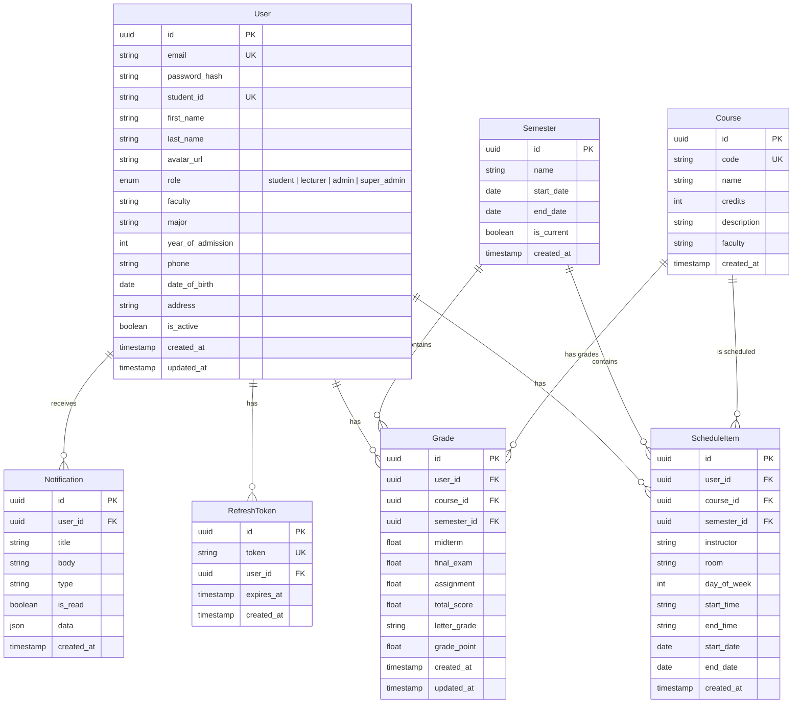

# Database Schema

## Tổng quan

Dự án sử dụng **PostgreSQL** với **Prisma ORM**. Schema được định nghĩa trong `apps/api/prisma/schema.prisma`.

Database được mở rộng dần theo từng phase — Phase 1 chỉ cần các bảng cốt lõi, Phase 2–3 bổ sung bảng cho tính năng mới.

---

## ERD Phase 1 — Nền tảng (hiện tại)



## Các bảng Phase 1

### Users
- Lưu thông tin sinh viên, giảng viên, admin
- `role` enum: `student`, `lecturer`, `admin`, `super_admin`
- `student_id` chỉ dành cho sinh viên
- **Phân quyền**: field `role` quyết định quyền hạn trong toàn hệ thống

### Semesters
- Quản lý học kỳ
- `is_current` đánh dấu học kỳ hiện tại

### Courses
- Danh sách môn học
- `code` là mã môn học (unique)

### ScheduleItems
- Thời khoá biểu của sinh viên
- Liên kết với User, Course, Semester

### Grades
- Điểm số của sinh viên
- Unique constraint: 1 sinh viên chỉ có 1 điểm cho 1 môn trong 1 kỳ
- **Phân quyền**: Student chỉ xem điểm mình, Lecturer nhập điểm lớp mình

### Notifications
- Thông báo gửi cho sinh viên
- `type`: `general`, `schedule`, `grade`, `event`, `system`, `deadline`
- `data`: JSON lưu thông tin bổ sung (ví dụ: deadline info, phòng mới)

---

## Bảng bổ sung Phase 2 (dự kiến)

> Các bảng này sẽ được thêm qua migration khi bắt đầu Phase 2.

### AttendanceSessions (Buổi điểm danh)
```
AttendanceSession {
    uuid id PK
    uuid schedule_item_id FK     # Buổi học nào
    uuid created_by FK           # Giảng viên tạo
    string qr_code UK            # Mã QR (random, có thời hạn)
    timestamp expires_at         # QR hết hạn sau X phút
    timestamp created_at
}
```

### AttendanceRecords (Kết quả điểm danh)
```
AttendanceRecord {
    uuid id PK
    uuid session_id FK
    uuid student_id FK
    enum status                  # present | late | absent
    timestamp checked_in_at
}
```

### Events (Sự kiện)
```
Event {
    uuid id PK
    string title
    string description
    string location
    string image_url
    timestamp start_time
    timestamp end_time
    int max_participants
    uuid created_by FK           # Ai tạo (Lecturer/Admin)
    string qr_code               # QR check-in sự kiện
    timestamp created_at
}
```

### EventRegistrations (Đăng ký sự kiện)
```
EventRegistration {
    uuid id PK
    uuid event_id FK
    uuid user_id FK
    boolean checked_in
    timestamp registered_at
    timestamp checked_in_at
}
```

### CourseRegistrations (Đăng ký môn học)
```
CourseRegistration {
    uuid id PK
    uuid user_id FK
    uuid course_id FK
    uuid semester_id FK
    enum status                  # registered | dropped | completed
    timestamp created_at
}
```

### Rooms (Phòng học / Lab)
```
Room {
    uuid id PK
    string name UK               # "A101", "Lab IoT"
    string building              # "A", "B", "E"
    int floor
    int capacity
    enum type                    # classroom | lab | meeting
    string equipment             # "Máy chiếu, máy lạnh"
    boolean is_available
}
```

### RoomBookings (Đặt phòng)
```
RoomBooking {
    uuid id PK
    uuid room_id FK
    uuid user_id FK              # Người đặt
    uuid approved_by FK          # Admin duyệt (nullable)
    string purpose
    date booking_date
    string start_time
    string end_time
    enum status                  # pending | approved | rejected | cancelled
    timestamp created_at
}
```

### ChatMessages (Lịch sử chat AI)
```
ChatMessage {
    uuid id PK
    uuid user_id FK
    string role                  # user | assistant
    text content
    json metadata                # tokens used, model, etc.
    timestamp created_at
}
```

---

## Bảng bổ sung Phase 3 (dự kiến)

### MapLocations (Địa điểm trên bản đồ)
```
MapLocation {
    uuid id PK
    string name                  # "Phòng A101", "Căn tin"
    string category              # classroom | lab | canteen | library | office
    string building
    int floor
    float latitude
    float longitude
    string description
    string image_url
}
```

### Books (Sách thư viện)
```
Book {
    uuid id PK
    string isbn UK
    string title
    string author
    string publisher
    int year
    string category
    int total_copies
    int available_copies
    string cover_url
}
```

### BookBorrows (Mượn / trả sách)
```
BookBorrow {
    uuid id PK
    uuid book_id FK
    uuid user_id FK
    timestamp borrowed_at
    timestamp due_at
    timestamp returned_at        # null = chưa trả
}
```

### LibrarySeats (Chỗ ngồi thư viện)
```
LibrarySeat {
    uuid id PK
    string zone                  # "Tầng 1 - Khu A"
    int seat_number
    boolean is_available
}
```

### SeatBookings (Đặt chỗ ngồi)
```
SeatBooking {
    uuid id PK
    uuid seat_id FK
    uuid user_id FK
    date booking_date
    string start_time
    string end_time
    timestamp created_at
}
```

### ParkingSlots (Chỗ đỗ xe)
```
ParkingSlot {
    uuid id PK
    string zone                  # "Khu A", "Khu B"
    string slot_number
    boolean is_occupied
    string vehicle_plate         # Biển số xe (camera nhận diện)
    timestamp last_updated
}
```

### ClassroomDevices (Thiết bị IoT phòng học)
```
ClassroomDevice {
    uuid id PK
    uuid room_id FK
    string name                  # "Đèn LED", "Máy chiếu", "Máy lạnh"
    string device_type           # light | projector | ac | fan
    string mqtt_topic            # "classroom/A101/light"
    boolean is_on
    json state                   # { brightness: 80, temperature: 25 }
    timestamp last_updated
}
```

---

## Hướng dẫn Migration

### Tạo migration mới
```bash
cd apps/api

# Sửa schema.prisma trước, rồi chạy:
pnpm exec prisma migrate dev --name <tên_migration>

# Ví dụ:
pnpm exec prisma migrate dev --name add_events_table
pnpm exec prisma migrate dev --name add_attendance_tables
pnpm exec prisma migrate dev --name add_room_booking
```

### Chạy migration trên production
```bash
pnpm exec prisma migrate deploy
```

### Reset database (chỉ dùng khi dev)
```bash
pnpm exec prisma migrate reset
```

## Seeding

Seed data được định nghĩa trong `apps/api/prisma/seed.ts`.

```bash
pnpm db:seed
```

Dữ liệu seed bao gồm:
- 1 Super Admin: `superadmin@uit.edu.vn` / `Password123`
- 1 Admin: `admin@uit.edu.vn` / `Password123`
- 1 Lecturer: `lecturer@uit.edu.vn` / `Password123`
- 1 Student: `student@gm.uit.edu.vn` / `Password123`
- 1 Semester: HK2 2024-2025
- Một số courses mẫu

## Quy tắc đặt tên trong schema

- Table names: `snake_case`, số nhiều (`users`, `schedule_items`)
- Column names: `snake_case` (`first_name`, `created_at`)
- Prisma model fields: `camelCase` (Prisma tự động map)
- Sử dụng `@map()` và `@@map()` để map giữa Prisma và DB naming
- Enum values: `snake_case` (`student`, `super_admin`)
