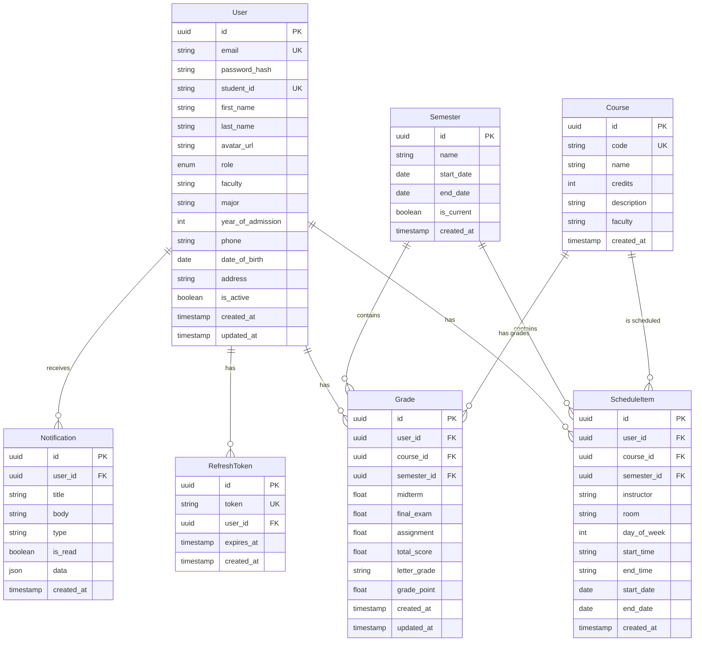

# Database Schema

## Tong quan

Du an su dung **PostgreSQL** voi **Prisma ORM**. Schema duoc dinh nghia trong `apps/api/prisma/schema.prisma`.

## ERD (Entity Relationship Diagram)



## Cac bang chinh

### Users
- Luu thong tin sinh vien, giang vien, admin
- `role` enum: `student`, `lecturer`, `admin`, `super_admin`
- `student_id` chi danh cho sinh vien

### Semesters
- Quan ly hoc ky
- `is_current` danh dau hoc ky hien tai

### Courses
- Danh sach mon hoc
- `code` la ma mon hoc (unique)

### ScheduleItems
- Thoi khoa bieu cua sinh vien
- Lien ket voi User, Course, Semester

### Grades
- Diem so cua sinh vien
- Unique constraint: 1 sinh vien chi co 1 diem cho 1 mon trong 1 ky

### Notifications
- Thong bao gui cho sinh vien
- `type`: `general`, `schedule`, `grade`, `event`, `system`
- `data`: JSON luu thong tin bo sung

## Migration Guide

### Tao migration moi
```bash
cd apps/api

# Sua schema.prisma truoc, roi chay:
pnpm exec prisma migrate dev --name <ten_migration>

# Vi du:
pnpm exec prisma migrate dev --name add_events_table
```

### Chay migration tren production
```bash
pnpm exec prisma migrate deploy
```

### Reset database (chi dung khi dev)
```bash
pnpm exec prisma migrate reset
```

## Seeding

Seed data duoc dinh nghia trong `apps/api/prisma/seed.ts`.

```bash
pnpm db:seed
```

Du lieu seed bao gom:
- 1 Admin account: `admin@uit.edu.vn` / `Password123`
- 1 Student account: `student@gm.uit.edu.vn` / `Password123`
- 1 Semester: HK2 2024-2025

## Quy tac dat ten trong schema

- Table names: `snake_case`, so nhieu (`users`, `schedule_items`)
- Column names: `snake_case` (`first_name`, `created_at`)
- Prisma model fields: `camelCase` (Prisma tu dong map)
- Su dung `@map()` va `@@map()` de map giua Prisma va DB naming
